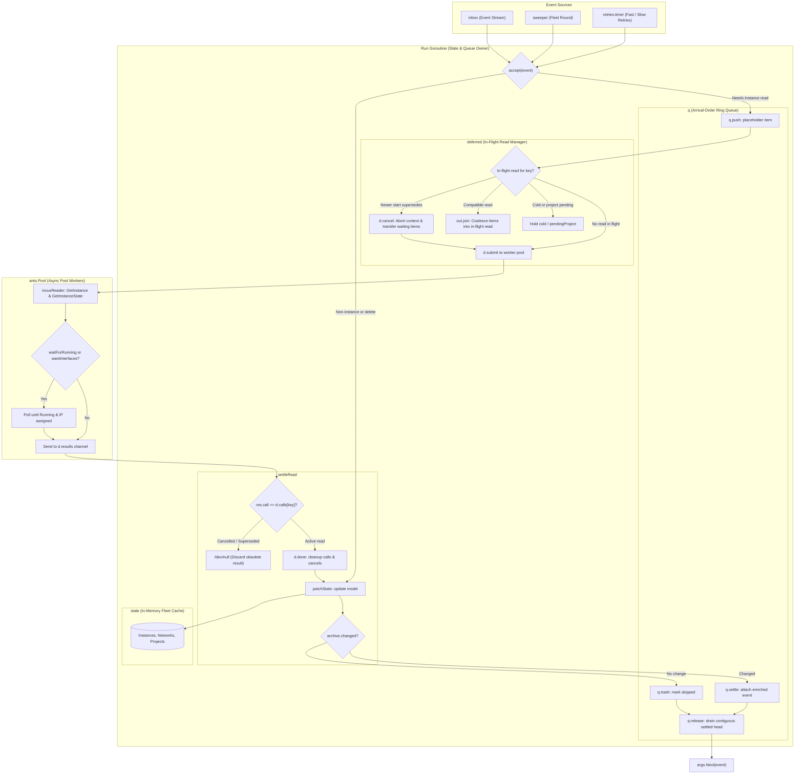

# enricher

Reads what an event's subject looks like now, and fills the rest of the event in
from what it already holds.

It asks for no read of its own. What it reads is what everybody else asked for:
`SetupArgs.Wanted` is the union of every plugin's `Wants`, so one action is one
lookup and one fetch plan, whoever after here needed it.

It does declare the actions its own dispatch acts on, with no enrichment against
them. An action nobody names is dropped by the source, so a branch here that
decides what an action costs would never run - the profile actions are those,
and without them a profile change reaches an instance only when the round next
reads it.

`profile-updated` is collapsible and `profile-deleted` is not. A profile carries
no history an update could lose, and each one costs a read per instance in the
project, so the last of a burst is the one worth paying for. A delete lost in a
burst is a delete lost.

It is a plugin at a position rather than something ahead of the chain, which is
what lets [[developer/ievent/debounce|debounce]] sit before and collapse a burst
before it costs a read.

## Internal Flow



## Four Things Happen Here

Only the first is a read of the event's own subject.

**An instance action** reads that instance. **One read in flight per key** - a
second event on the key joins the read already running, or cancels and
supersedes it if the new event requires waiting for running state (such as
`instance-started`). Coalescing saves the read, not the event: both still walk,
carrying what it found.

**A network action** patches the wire and re-reads everything sitting on it,
because a subnet moving changes every record on that wire.

**A profile action** re-reads every instance in the project, because a profile
re-expands their configuration and devices and the event names none of them. The
model already knows who they are, so the project is never read to find out.
Except a delete: Incus refuses to delete a profile still expanded into anything,
so the event names a profile no instance uses any more, and fanning out would
read a whole project's instances to learn nothing changed.

**A round** goes over the whole fleet by name, for ever, at its own pace. Each
name it hands back takes the first path above; what it holds and the listing
does not is dropped.

The middle two are fan-out. They issue reads through the pool; once settled,
each updated instance is handed forward through `next`, skipping `Command` so
`debounce` does not collapse them into one.

A network and an instance called the same thing in one project would otherwise
share a read: the key each flight is filed under is prefixed with which kind it
is, so the two can never collide.

## Every Event Carries Its Project's Labels Too

Before any of the four paths above, an event whose action somebody wants
`EnrichedProject` for gets the owning project's own configuration attached - not
a read of its own, but what the round already holds from its project listing,
read once per whole-fleet pass rather than again each time one of its instances
moves.

A project the pass has not reached yet is left unenriched rather than enriched
with nothing, so a consumer can tell "this project sets none" from "this project
has not been read" - both would otherwise arrive as the same empty map. An event
naming a project the model does not hold issues a targeted project read through
the pool rather than waiting on the next round. Once the read lands, the
project's config is stored, and the enricher fans out re-reads over that
project's instances so their events walk with labels attached.

## An Incomplete Read Is No Read

A NIC naming a network nothing has read cannot be placed, and what is left is a
subset of where the instance actually sits. So nothing is stored, nothing is
filed, and the events waiting on it fail the same way a read that errored fails
them - the key is simply owed another read.

Storing the subset is what made it permanent, and it cost a whole e2e run to
find. An instance read a second before its network was created recorded only the
wires that already existed. It was then not on the new wire, so the
`network-updated` that would have fixed it fanned out over `instancesOn` -
everyone already known to be there, which is everyone except it. Nothing looks
again: a wire arriving is not an instance event, and a lease writes only
`volatile.*`, which is stripped before the comparison. The record answered on
one wire and was missing on the other for the life of the process.

The same rule covers a rename in flight, where the old key is gone and the new
one has not landed. **A wire that is unknown is always one that is about to be
known**: an instance is created on a network that already exists, and a managed
network anything is attached to cannot be deleted.

## Local Patches, Not Re-Reads

An event says what changed, and what changed is one instance, one network or one
project. A delete deletes; a rename drops the old key. Reading the fleet to
learn what a delete already told us is the cost the model exists to avoid.

The model belongs to the goroutine `Run` owns. Nothing in it is locked, and
nothing in it may be touched from a pool worker: a worker reads Incus and hands
the answer back, and the patch happens where the model lives.

## Unchanged Goes No Further

The last event emitted about each subject is kept, keyed by the kind its action
names and the subject's project and name. What a read found is compared against
it, so a wire that moved is one event rather than one per instance sitting on
it - the fan-out is where a fleet-sized burst of "nothing changed" comes from.

`Event.Equal` is structural rather than a hash: a collision would read a real
change as a repeat, and this is two events rather than a fleet. It leaves out
what is not about the subject - when the event was decoded, what the chain was
doing, whether the answer was restored from the cold store, and a plugin's own
values. Two things it deliberately keeps: the action, so a stop is never
absorbed by the update before it, and whether a read landed, because "no
networks" and "nobody asked for networks" are different answers.

**An event that says nothing new goes nowhere**, whoever sent it. Most of what a
busy fleet emits is one: `volatile.*` is stripped before the comparison, so a
DHCP lease renewal writes keys nobody here reads and produces an
`instance-updated` identical to the last one.

What differs is how each stops. A real event already holds a place in the line,
taken when it arrived and before its read landed, so it is trashed in place and
skipped on the way out. The place stays until it reaches the front: an
`instance-deleted` needs no read and settles at once, so pulling the place out
from under it would let the delete overtake the update before it.

A fan-out event has no place to keep. They are created in one burst, so their
order among themselves says nothing, and a live event on the same key joins the
same read rather than racing it. The read is issued without one, and the event
goes in only if what came back was worth it. On completion the real events
settle first, so the invented one is compared against what they just filed -
which is how a live event and a fan-out on one key stay one event.

A failed read files nothing. What the next read finds is compared against the
last answer there was, never against a failure.

**One instance read is absorbed in one place**, whether an event asked for it or
a round brought the name back. The patch and what the key is owed are decided
together, so the two paths cannot come to different conclusions about the same
answer - a state read that failed fails the event and retries soon, while a
running instance holding no address is a lease that has not landed yet and is
also retried.

## Order Survives Concurrent Reads

Reads run in the pool and land in whatever order Incus answers. What leaves the
enricher is still the order it arrived: an event goes when its own read has
landed **and** everything ahead of it has already gone.

The cost is head-of-line blocking **on delivery alone**. A slow read at the
front holds up what is after it, but never holds up their reads - those are
already running. Throughput is the pool's; latency is the slowest read still in
flight.

Every plugin after this one inherits that order for free rather than each
rebuilding it. A `create` landing after the `delete` that superseded it is a
correctly locked wrong answer, and nothing downstream can undo it.

The line is a ring rather than a slice reslicing forward, so the array is reused
instead of the front being abandoned and reallocated every time it fills. It
doubles and halves, so a fleet-wide burst does not leave it permanently the size
of the worst moment it ever had. One goroutine pushes, settles and releases, so
it holds no lock.

It is unbounded on purpose, and `ReadTimeout` is what keeps it finite: the head
always settles inside one timeout, so the line only ever holds what arrived
during it. `debounce` before and per-key coalescing after make that a small
number. A timeout raised far enough would move that bound.

## The Key First, The Round After It

A read that failed, and a read that found a running instance with no address,
fail their event immediately and read that one key again a second later, three
times. **Nothing retries inline** - the events queued after that one would wait
out the whole delay.

A second, because when an address appears differs widely between Incus LTS and
daily, and a round is far too blunt an instrument for a lease that is one moment
late. A re-read goes through the fan-out, so what it finds reaches the chain as
an event of its own; a key that settles has its attempts cleared and starts
again from three.

A key those attempts did not fix waits for the round, which reaches every name
there is. Nothing pulls a round in early: a daemon having a bad minute would
otherwise be met with one round per failure, and the round is the thing that
must not be hurried.

Spending the three fast attempts does not hand the key to the round outright -
repair never stops, it only slows, to one read every five seconds, for as long
as the key keeps failing. Stopping would mean waiting on a round that is hours
away by design, and the common case here is an instance read that landed between
its start and its lease - a gap nothing else ever announces, so nothing but
another read closes it.

A wire is not re-read at all. The fan-out creates `instance-updated`, so handing
it a network would have the daemon asked for an instance named after the wire -
which is the bug the action prefix exists to prevent.

## The Round

A goroutine `Run` starts, going over the fleet for the life of the process. It
sends on a channel and touches nothing else - not the model, not the queue -
which is what keeps this package free of a mutex.

Names, never listings. `GetProjectNames`, `GetNetworkNames` and
`GetInstanceNames`, then a read per name. Two phases, because the wire map has
to be whole before an instance distills against it:

```
projects:  names -> a read each -> prune what is no longer served
networks:  per owner: names -> a read each -> prune that owner's
           -> warm, which thaws whatever was held back
instances: per project: names -> prune -> then one name at a time
round end: enricher/sweep-end
```

Each name becomes a bare `instance-updated` taking the same path a live event
does, so an unchanged instance costs a read and no event.

**Cold until the first pass warms it.** An instance read arriving before `warm`
is held rather than issued - joined into a flight the same way a concurrent read
on the same key would be, just never submitted - and released in arrival order
the moment the round's network phase lands. Only instance reads wait: a network
read patches the one wire it names directly, and a profile or network fan-out
only ever names instances the model already holds, which is nothing while cold
either way. Once warm, it never goes cold again - a reconnect leaves the wires
exactly as stale as everything else this plugin holds, which is what the pass
that follows one is for.

**Two rates.** The first round runs at no delay, because nothing is served until
it lands. So does one that follows a round abandoned for a reconnect or given up
on because the daemon would not answer: both leave what is held as old as
whatever went wrong. Every other round is paced by one `ReadDelay`, between
projects and networks and the instance reads alike - and `SweepInterval` sits
between rounds, or a fleet read in no time is read again immediately, for ever.

**A round that broke is tried again soon.** `SweepInterval` follows only a round
that reached its end. One that broke - a listing of projects that failed or
timed out, or a project whose instances could not be listed - is followed after
a backoff instead: one second, doubling each time it breaks again, never more
than thirty. Waiting the interval would leave what is held unconfirmed, and
every instance read held back until a round reaches the networks, for hours. The
end of a round, and the warm it carries, is raised as soon as one reaches its
end, and only then.

**Absence is decided against what was asked about.** The model's keys in a scope
are recorded when that scope's listing goes out, and what is pruned is that
record minus the listing. A name created while the request was in flight is not
in the record, so it survives - and it had to, because nothing would put it
back: the next round reads it unchanged and emits nothing.

**A prune emits an `instance-deleted` event.** What a project listing does not
have has gone. The enricher creates synthetic `instance-deleted` events for
missing instances and passes them through `accept`, updating the model, dropping
their archive entries, and releasing them downstream so plugins like
[[developer/dns|dns]] and `checker` learn about the deletes. The listing of
projects does the same for every instance of a project it left out - one that
went, or one this binary no longer serves - before the project is dropped.

That includes a listing that succeeded and is empty, which is what a certificate
restricted to `projects: []` answers - and what one restricted to a project that
was deleted and created again is left with. Every name goes at the first round,
where v1.4.0 dropped the projects from what it held without telling the chain
and kept answering.

So does a read that finds an instance it held gone: a 404, or one the `Instance`
predicate no longer serves. A live delete may be on its way with the same news,
but one that happened while the stream or the process was down is not, and a
fan-out that reaches it before the listing leaves the listing nothing to prune.
A second delete for one name changes nothing downstream. Unless a read of the
same key was asked for while this one was out: its events are ahead in the line
of where the delete would go, and an instance made again under the name in
between would reach the chain and then be taken away by the older news. The
delete is owed by the key instead (`owedDelete`), not by that read: the next
read of it that lands announces it if it finds the instance gone, however many
fail first, and a listing that leaves the instance out announces it too. A
read finding it there owes nothing any more.

**Nothing older than an event undoes it.** A network read already out when its
network is updated is followed by a read of its own, as an instance read is,
and one out when the network is deleted or renamed away is abandoned. Beyond
that, the time of the last event about each network is kept, and a read or a
listing of it asked for before then - the sweeper's, or a read a tenant's NIC
asked for under the tenant while Incus answers with the default project's
network - is not taken. A listing of instances or projects is no news about an
instance a read answered after it went out: it may have been made since, and
it is not pruned.

**A listing that failed prunes nothing.** An empty answer and a daemon that
would not answer arrive the same way, and one of them means every name in the
project. A failed listing - of instances or of networks - also keeps the round
from being done: what that project holds has been neither confirmed nor pruned,
so the round goes on through the other projects, then ends as one that broke.

A listing that fails for good would hold the chain cold for good, so it is
bounded like a failed read (`endBroken`): once `roundGrace` has passed since the
first run that broke, a run breaking on listings alone ends all the same, with
a warning naming each listing and its error, and the next run that breaks
waits a whole grace of its own. A failed network listing always counts: the
inventory held is what instances are placed by. A failed listing of a
project's instances counts only where that project's instances were listed -
the project's own `listed`, written to the cold store with it and gone with
it, so a project made again under the same name, or one whose configuration
alone was stored, has none. A failed listing of the projects counts once one
succeeded, here or in the run that wrote the store, empty included. A first
start that never listed them stays cold. The run ends at the first broken run
past the grace, so up to one backoff (30 s) after it, and the reads held back
for the run's networks - a run broken before them never reads them - fail
ahead of its end rather than hold it in line, and go out from then on.

A listing of a project's networks asked for after an event about one, with no
network read out, makes that event old news: the time kept for it goes, so the
history does not grow with every network name a project ever had.

`enricher/sweep-end` is raised through `Command`, which enters at the head of
the chain, because everything _before_ here has to see it too. It says a round
has been all the way round; it never says what exists.

**A round ends once what it listed has been read.** The end's command stamps
the chain warm at once, so everything raised after it - a name whose read
failed, retried later - reaches the chain behind a round already called whole,
and a name nothing downstream has yet would read as absent for good. An
instance the listing has and nothing holds, or one whose read failed and that
nothing holds, is `unread`; the end waits until each has a read that landed (a
404 and an unserved instance count), has been deleted, or a listing no longer
has it. One that keeps failing holds the end for `roundGrace` (a minute) and no
more, armed the first time a run held at its end has anything unread - at its
end or on a read failing later: past it the round ends with a warning, and its
name waits on the retry like any other. A held instance whose read fails waits
on nothing: what it holds is already downstream.

A reconnect abandons the run under way and its end with it, held or not.
Messages carry the run they belong to, and those of an abandoned one - whose
send races the cancel - are not listened to. The end of a run names the stream
session of the connected that started it, and the source takes it only in that
session with the stream open (see [[developer/ievent/source|source]]): the run
`Run` starts before any stream opened, and one whose end is still in flight
when the stream comes back, end nothing. A connected is never dropped at a
full inbox: it waits in a slot of its own, the newest kept, taken behind what
the inbox held. And any event of a session newer than the run's starts the
run for that session, so the run follows the stream even where its connected
did not get here. The chain state is taken only from events of the session the
run reads for - a warm one of the session before, late out of a queue, says
nothing of a stream that came back cold - and what the enricher mints carries
that session.

A listing announces a delete owed for a key only when it was asked for after
the read that found the instance gone, with no read of the key out: that one
was asked for later and decides. A project the listing of projects had and
the configuration leaves out (`excluded`) is pruned whatever was read in it
since; only one the listing did not have may be one made since.

## A Start Replays What The Last One Held

With `StoreFile` set, what is held is written every `StoreInterval` and once on
the way down, and read back by the next start in `New`. A file that is missing,
cannot be decoded, or carries a `version` this binary does not know starts cold
with a log line, the way a start without a store does; a file with no `version`
at all is what v1.4.0 wrote, and is the same shape as version 1.

What is read back is cut to the configuration of this start before anything sees
it: a project the `Project` predicate no longer serves - `--project` or the
marker changed between the two starts - keeps its networks, which an instance in
a served project may sit on, and loses its instances and its configuration. A
project whose configuration was never read cannot be asked and goes the same
way. A project the certificate no longer sees cannot be told from the file; the
first listing of projects prunes it, and announces every instance it held.

Before the first round starts, `Run` hands on every instance held as the
`instance-updated` a read of it would have made, with its instance and project
attached, stamped `ChainCold` and marked `Restored`, and files each in the
archive. A consumer serves it at once, and one that must not act on a stale
answer can tell it from a read: **the round's first read of each instance is
handed on once even where nothing changed**, carrying `Restored` false, and
after that an unchanged read goes no further, as before. Whatever moved while
the process was down the round corrects like any other change, and whatever went
it deletes.

A first round that breaks leaves the replay standing, unconfirmed, until one
reaches its end; how soon the next is tried is the sweep retry's business.

The replay goes through the successor's `Handle` in one burst. A fleet larger
than the successor's inbox (1024 by default) has the excess dropped there; the
round brings each of those back as a read that differs from the restored one.

## The Numbers

|                 |                                                                               |
| --------------- | ----------------------------------------------------------------------------- |
| `Workers`       | 16, capping reads in flight against one endpoint                              |
| `ReadTimeout`   | 10s, one instance read or one listing                                         |
| `InboxSize`     | 1024, matched to the Incus client's own event channel                         |
| `ReadDelay`     | 5s between the reads of a round - projects, networks and instances alike      |
| `SweepInterval` | 6h between the end of one round and the start of the next                     |
| sweep retry     | 1s after a round that broke, doubling to 30s, until one reaches its end       |
| `StoreInterval` | 5s between writes of what is held, so a start finds at most that stale        |
| `StoreFile`     | the cold store (`enricher-cold-store.json`), read back at start; empty is off |
| `TTL`           | 0 (disabled), duration to keep held entries valid before re-reading           |
| `Metrics`       | false, enables Prometheus counters and gauges                                 |
| repair delay    | 1s, three attempts per key, then one every 5s for as long as it keeps failing |

How stale the fleet gets is `ReadDelay` times how much of it there is, and there
is no safe direction: long is a longer window for a quirk nothing announced,
short is paying for the round and the events at once.

One Incus endpoint can front a hundred machines, so every bound here is
fleet-wide rather than per project.

## Reading Incus Correctly

Lifecycle actions are prefixed with the entity they happened to, and that prefix
is load-bearing: without it a name is a name, a `network-updated` carries one
too, and asking the daemon for an instance called `net0` is the bug that shape
invites.

Networks are read per owning project. A project with `features.networks` owns
its own, so one listing answers for that project alone; otherwise a bridge lives
in `default` and other projects reference it. Owners are found with
`incusutil.IsTrue`, because `"1"` and `"yes"` own their networks too.

## Known Gaps

- **A state read that fails fails the event**, scheduling a fast retry without
  updating the model; a running instance holding no address (e.g. pending DHCP
  lease) records as address-less and is also retried.
